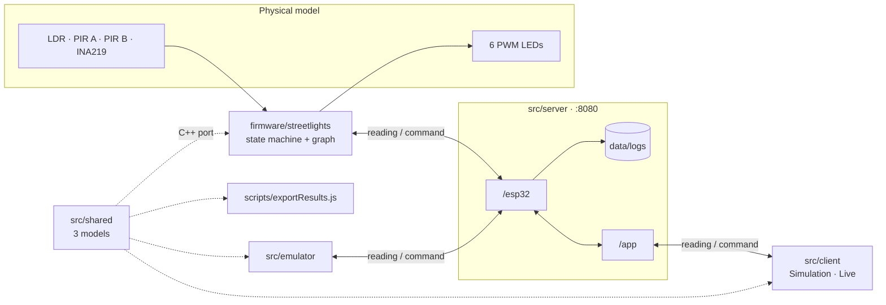
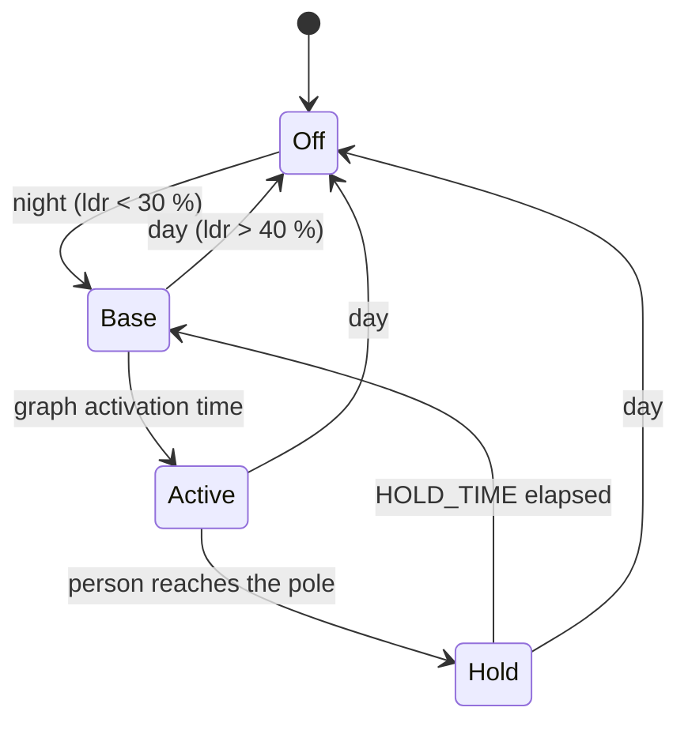
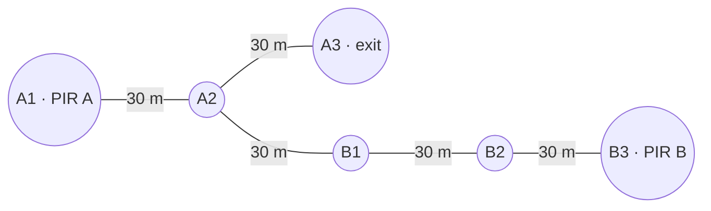
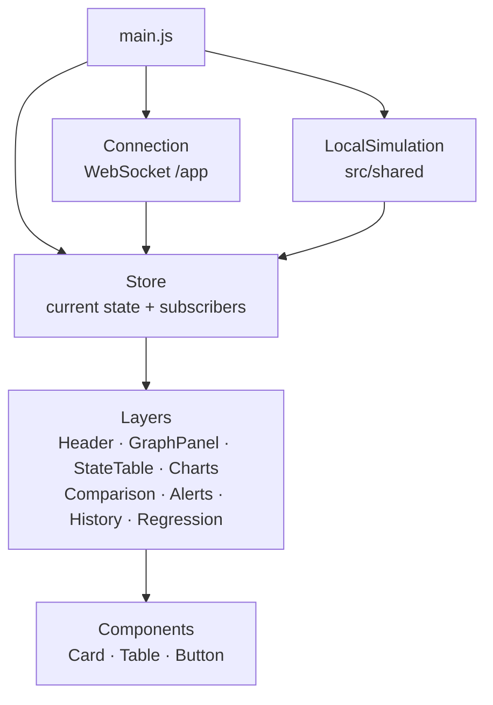

# Architecture

## Systems

| System | Responsibilities |
|---|---|
| `src/shared` | Implements the 3 models with no I/O. Simulates a full night and computes the indicators |
| `src/server` | Serves the app and the shared models. Bridges the WebSocket routes and logs CSV files. Raises an alert after 3 s without the device. Prints the LAN IP |
| `src/emulator` | Pretends to be the ESP32: sends readings every 500 ms, answers every command and adds noise to `powerMw` |
| `firmware` | Decides each pole's state **on the board**, so it keeps working without WiFi. Drives the PWM and reports readings |
| `src/client` | Dashboard with two modes: local simulation and live mirror |

## Luminaire states

## Street graph

## Client

