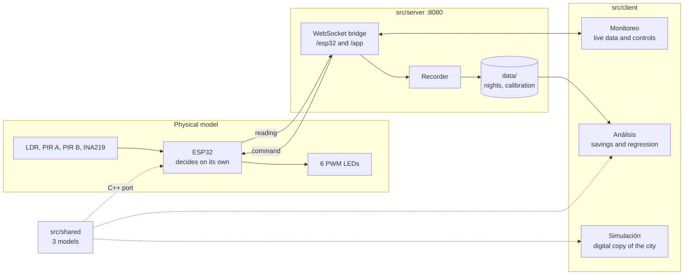
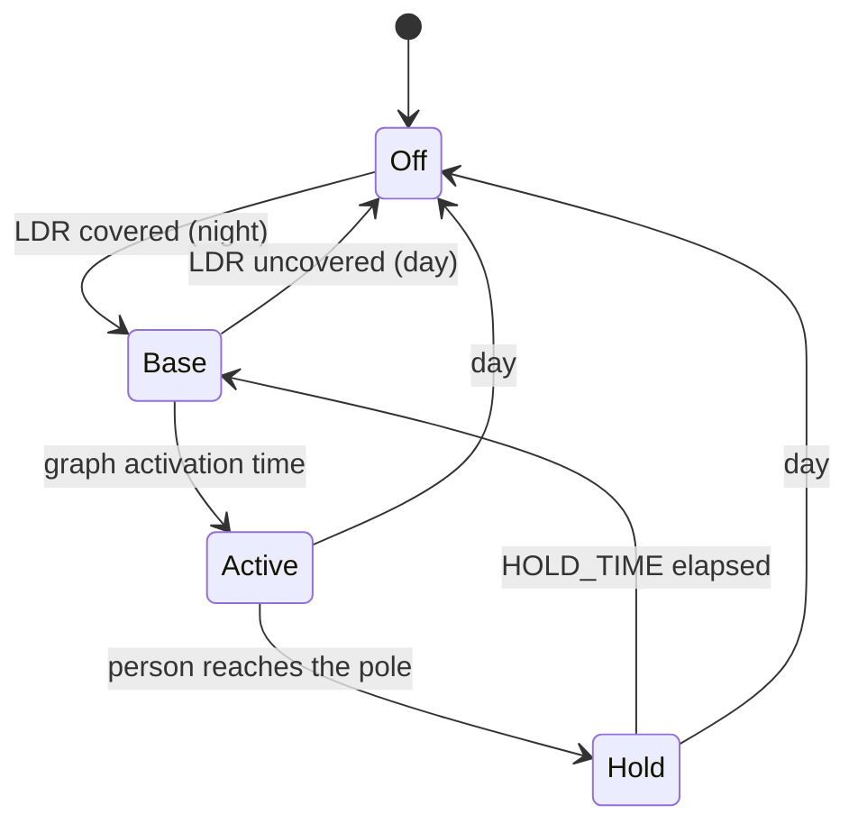
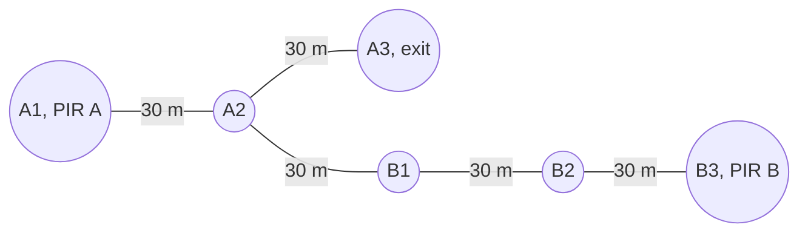

# Architecture

## How the system works

| Part | Responsibility |
|---|---|
| ESP32 (`firmware/`) | Reads the sensors, decides day or night with the LDR, runs the state machine and the light wave, drives the LEDs and reports every 500 ms. Works without WiFi |
| Server (`src/server/`) | Serves the app, forwards readings to the browsers and operator commands to the board, records each night and calibration, and warns after 3 s without data |
| Monitoreo | What happens right now: map, day or night, clock, measured power, people detected and alerts. Operator controls: strategy, lamp test, calibration |
| Análisis | Recorded nights, observed savings next to simulated savings, and the consumption regression |
| Simulación | A full 12 h night with 5, 20 or 60 people, the comparison of the 3 strategies and the Dijkstra table |

## Luminaire states

## Street graph

